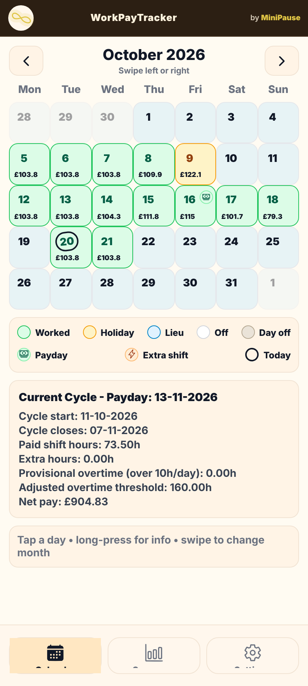
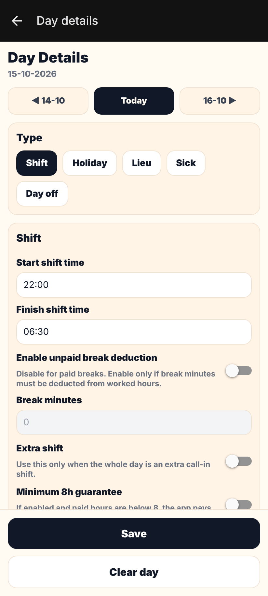
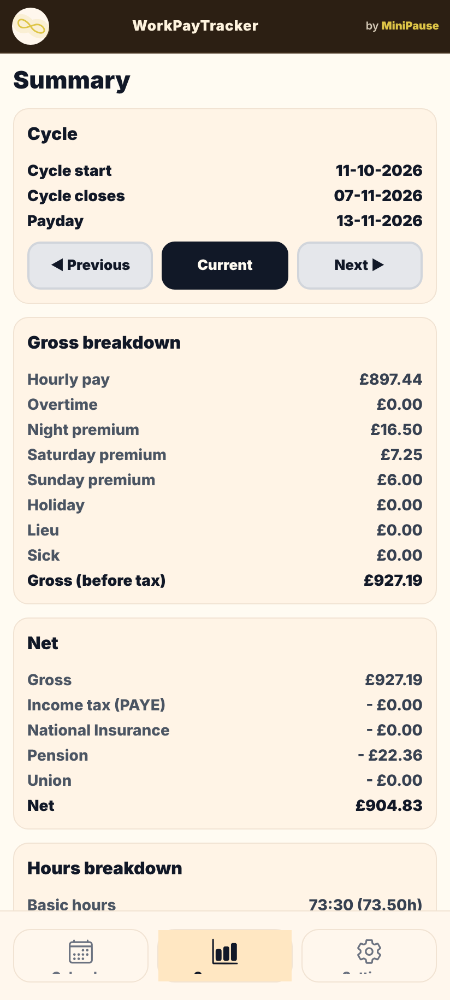
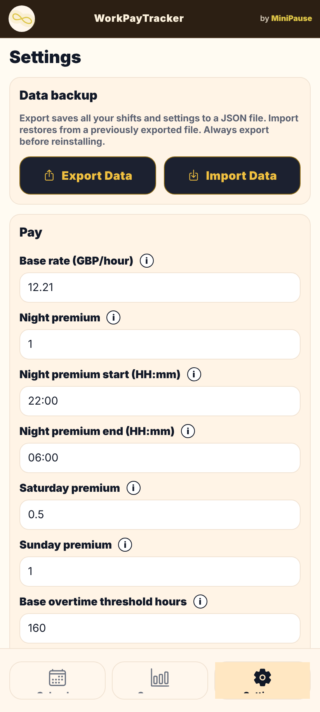

# WorkPayTracker

An Android app for UK shift workers who want to know what their next payslip should say. You log each shift and the app estimates gross pay, PAYE, National Insurance, pension and net pay for the current pay cycle.

I built it because my own payslips were hard to check. Night shifts, weekend premiums and a four-weekly pay cycle made the numbers hard to follow by hand. The pay logic was checked against five real payslips and matched gross pay to within £1.

<p align="center">
  
  
  
  
</p>

<p align="center"><sub>Screenshots use invented test data.</sub></p>

## Features

- **Shift calendar.** Mark each day as a shift, holiday, lieu day, sick day or day off. Each worked day shows its estimated gross.
- **Premiums by time window.** Night, Saturday and Sunday premiums are applied hour by hour, including shifts that cross midnight.
- **Overtime and extras.** Configurable overtime threshold and multiplier, extra-shift multiplier, double pay on Christmas Day, Boxing Day, New Year's Day, Good Friday and Easter Monday, a minimum 8-hour guarantee and unpaid break deduction.
- **Pay cycles.** 7, 14 or 28-day cycles, set either from a known payday or from manual start and end dates.
- **Net pay estimate.** PAYE from the tax code (including BR, D0, D1 and NT), employee National Insurance, workplace pension on qualifying earnings and an optional union fee.
- **Summary.** Gross and net breakdown per cycle, hours breakdown and cumulative pay across the tax year.
- **Backup.** Export all shifts and settings to a JSON file and import them again.

## Privacy

All data stays on the phone. The app stores shifts and settings locally with AsyncStorage. It has no account, no server and no analytics. Backups are files the user exports and keeps.

## Tech stack

| Area | Technology |
| --- | --- |
| Framework | React Native 0.83, Expo SDK 55 |
| Language | TypeScript |
| Navigation | Expo Router (file-based routes, typed routes) |
| Storage | AsyncStorage |
| Graphics | react-native-svg |
| Dates | date-fns |
| Build | EAS Build (Android APK) |
| Package manager | Yarn |

## Project structure

```
app/
  (tabs)/index.tsx      Calendar and current cycle
  (tabs)/summary.tsx    Cycle and tax-year summary
  (tabs)/settings.tsx   Rates, deductions, pay cycle, backup
  day/[date].tsx        Add or edit one day
src/
  lib/pay.ts            Pay, tax, NI and pension calculations
  storage/              AsyncStorage wrappers for days and settings
components/
  ui/                   Shared buttons and switches
  minipause/            MiniPause brand banner, logo and splash
constants/theme.ts      Colours
```

## How the pay estimate works

1. Each shift is split into segments at midnight and at the night-premium boundaries.
2. Base pay is hours × base rate. Night, Saturday and Sunday premiums are added per hour inside their windows.
3. Overtime applies to paid hours above the cycle threshold. Holiday and lieu days reduce the threshold.
4. PAYE annualises the cycle gross (×13), applies the tax code allowance and the 20%, 40% and 45% bands, then divides by 13. National Insurance is 8% above £968 per four-week period. Pension is a percentage of gross above a configurable threshold.

The result is an estimate. Real payroll uses cumulative PAYE across the tax year, so individual payslips can differ from it.

## Validation

I compared the app with five real payslips from the same employer. Gross pay matched within £1 on each one. The pension calculation, 5% of gross above the qualifying-earnings threshold, matched to the penny. The payslips themselves are not in this repository.

## Download

The Android APK is attached to the latest [release](https://github.com/Ioksan/WorkPayTracker/releases). It installs outside the Play Store, so Android will ask you to allow installs from that source.

## Run it locally

You need Node.js 20 or later and Yarn.

```bash
git clone https://github.com/Ioksan/WorkPayTracker.git
cd WorkPayTracker
yarn install
npx expo start
```

Then press `a` to open it on an Android emulator or device with a development build, or `w` to open the web version in a browser.

To build an installable APK with EAS:

```bash
npx eas-cli build -p android --profile preview
```

## Limitations and next steps

- PAYE and NI are calculated for a four-week period. Weekly and fortnightly cycles track pay correctly, but their tax and NI figures are not yet scaled to the shorter period.
- PAYE is non-cumulative, so it does not reproduce week-1/month-1 or cumulative tax codes exactly.
- NI uses the 8% main rate only, without the 2% rate above the upper earnings limit.
- Only one job and one pay rate at a time. No student loan, salary sacrifice or Scottish income tax bands.
- Tax and NI thresholds are set in code and need updating each April.
- Next: scale tax and NI to the cycle length, add unit tests for `pay.ts` using anonymised payslip figures, and add a CSV export for the summary.

## Licence

[MIT](LICENSE) © 2026 Andrei-Cosmin Tutea. Built under the MiniPause brand.
